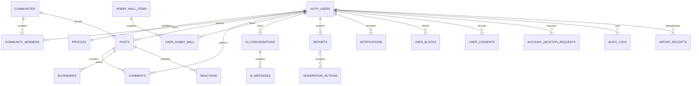

# HerIsland Phase 0 / Phase 1 migration foundation

Status: implemented locally; NOT connected to or applied against hosted Supabase. No deployment performed. Existing local demo remains the default. Current user authorization for production migration supersedes the repository's older local-demo-only restriction; no local Ollama setting was changed.

## Runtime and scope

Next.js 16.4.5, React 19.3.1, TypeScript 6.0.3, Node 24.x. Official `@supabase/ssr` 0.12.7 + `@supabase/supabase-js` 2.119.0. Next 16 `src/proxy.ts` refreshes cookie sessions with `getClaims`; protected Server Components and mutations verify the user using `getUser`. Authenticated responses are dynamic/private/no-store. Client localStorage is never accepted as identity.

`NEXT_PUBLIC_DATA_MODE=demo` (default) keeps existing local functions intact. `supabase` enables real registration/login/session protection. It does NOT automatically migrate forum posts, comments, bookmarks, community membership, Sunny history or local wall editing to server repositories. Those UI adapters are Phase 2 work. The profile header can display the verified account while clearly labeling remaining demo content. Do not open real registrations for production merely because Auth code exists.

## ER relationships

`women_profiles` is independent editorial reference content. Moderation/audit targets deliberately keep UUID/text identifiers instead of cascading away their evidentiary history; report targets are visibility-validated by a trigger. `app_private.admins` is non-client-readable, writable only by a trusted operator/service role, and is never populated from editable user metadata.

## Migrations

1. `202611100001_phase1_schema.sql`: 19 requested public tables + import receipts (20 public tables total); RLS, explicit grants, indexes, profile trigger, private upload bucket and transactional wall RPC.
2. `202611100002_reference_seed.sql`: deterministic/idempotent 6 communities, 74 wall assets and 102 women, including all source records. Only 10 published women are anonymously readable; research/verified records remain private. Creates NO users, demo posts or comments.
3. `202611100003_explicit_import.sql`: explicit authenticated/idempotent wall import; profile backfill; same-post comment-parent constraint.
4. `202611100004_report_integrity.sql`: report-target integrity and visibility validation.
5. `202611100005_editorial_boundary.sql`: full editorial records private; published public projection and safe 102-name directory function.

The seed is generated by `node scripts/generate-supabase-seed.cjs`. Review changed reference geometry before creating a future forward migration; never rewrite already-applied migrations in a deployed database.

### RLS and grants matrix

| Tables | Anonymous | Authenticated user | Trusted service/operator |
|---|---|---|---|
| profiles | Active public nickname/bio/avatar path only | Edit own non-privileged fields | Status/moderation |
| communities | Active public communities | Also private communities where a member | Create/archive/admin |
| community_members | None | Own membership; join public, leave own | Manage memberships |
| posts | Published visible posts | Own draft/read/edit; insert own author ID; membership required for group posts | Moderation |
| comments | Published comments on readable posts | Create/edit own, same-post parent only | Moderation |
| bookmarks, reactions | None | Own rows only; readable post required on insert | Operations |
| hobby_wall_items | Active reference assets | Read only | Reference updates |
| user_hobby_wall | None | Own rows/RPC only | Operations |
| women_profiles | Published projection only; 102 safe names via women_directory() | Same, no editorial notes | Full editorial records/publication |
| ai_conversations, ai_messages | None | Own conversations; user-role messages only | Insert assistant/system replies |
| reports | None | Submit/read own reports | Review and resolve |
| moderation_actions, audit_logs | None | No access | Write/read |
| notifications | None | Read own; update read_at only | Create |
| user_blocks | None | Own block list only | Operations |
| user_consents | None | Own consent records; update granted only | Compliance operations |
| account_deletion_requests | None | Request/read own pending deletion | Execute lifecycle |
| import_receipts | None | Own read; writes only by scoped import function | Operations |
| private Storage bucket | None | Own UID-prefixed paths | Controlled cleanup |

Writable policies check active profile status. Foreign-key deletes cascade personal content; audit/moderation actor references become null. Published profile columns deliberately exclude emails and auth metadata. No self-assigned administrator columns exist.

### Wall transaction

`slot CHECK (1..5)` plus `UNIQUE(user_id,slot)` makes a sixth item impossible even with concurrent inserts. Owner uniqueness also prevents duplicates. Advisory per-user transaction locks, reference mount validation, scaled collision bounds, board bounds and 24-unit grid validation run in a database trigger. `save_hobby_wall(jsonb)` replaces an entire wall atomically, so any invalid placement rolls the transaction back. All 74 assets and their actual geometry are seeded.

## Auth and backend routes

- `/api/auth/register`, `/login`, `/logout`, `/reset`, `/update-password`, GET `/api/auth/session`.
- `/auth/callback`: PKCE code exchange; `/auth/confirm`: token hash verification for signup/recovery/email only.
- `/auth/reset?request=1`: request recovery mail; `/auth/reset`: authenticated password update.
- `/auth/import`: verified destination ID/email + source preview + explicit consent, optional explicit cloud-wall replacement.
- `/api/import/hobby-wall`: ignores claimed ownership, verifies server user, compares confirmed destination, hashes validated source and calls scoped RPC.
- `/api/uploads`: authenticated, bounded 5MB image upload with MIME + PNG/JPEG/WebP signature checks and generated owner-prefixed filename. No SVG/HTML, no filename trust, private bucket. Bucket size/MIME rules also apply to direct Storage access. Signature checks are not malware scanning or full image decoding; quarantine/scanning is future production work.

No service-role key is imported into application client code. Public URL/publishable key are intentionally public. Avoid untrusted `getSession().user` authorization; refresh/claims do not replace server verification. Origin checks reject cross-site mutations; redirect targets reject encoded/control-character open redirects. User text is rendered through React escaping, not raw HTML.

## Staging setup — operator actions, not executed

1. Create a separate Supabase staging project (Postgres 17). Keep production separate. Record region, backups and retention.
2. Enable Email Auth and email confirmation; configure strong passwords, custom SMTP, allowed redirect URLs, Auth rate limits and CAPTCHA. CAPTCHA UI plumbing is not yet included; enabling provider CAPTCHA requires its follow-up integration before signup can work.
3. Set Site URL to the exact staging web origin. Allow `/auth/callback` and `/auth/confirm`. Signup email template can use `{{ .SiteURL }}/auth/confirm?token_hash={{ .TokenHash }}&type=email`; recovery template uses the same route with `type=recovery`. PKCE callback is also implemented. Do not log token hashes.
4. Using the current official Supabase CLI, authenticate and link the staging project; run `supabase db push --dry-run --remote`, inspect output and target project, then apply with `supabase db push --remote`. These commands were NOT executed here. Never run against a populated project before backup and review.
5. Configure `.env.local` or Vercel Preview secrets: `NEXT_PUBLIC_DATA_MODE=supabase`, public URL/publishable key, `APP_ORIGIN=https://exact-staging-origin`. Do not put service-role keys in NEXT_PUBLIC variables. Changing NEXT_PUBLIC mode requires a rebuild.
6. Set staging-only test variables listed in `.env.example`, including `SUPABASE_TEST_EXPECTED_PROJECT_REF` and a locally stored `SUPABASE_ACCESS_TOKEN`. Run `node supabase/tests/staging-preflight.mjs` first: its GET-only checks verify that the remote project name is exactly `herisland-staging` and matches the expected ref. Remote migration writes still require explicit user confirmation and a reviewed backup. Then run `RUN_SUPABASE_INTEGRATION=1 node supabase/tests/integration.mjs`. This creates two fresh staging test users and cleans up only those users. It must never use production credentials.
7. Manually test real email confirmation/recovery, sessions on two browsers, refresh/logout, denied cross-user access, uploads, revoked sessions and Storage cleanup. Do not open public registration before policy/content/billing/abuse readiness.

## Data preservation and rollback

- Full working-tree backup (excluding secrets/Git/dependencies/build output) was created at `/tmp/herisland-pre-release-20261110.tar.gz`; browser data was not touched. Preserve a separate secure backup of environment files, which were excluded and not modified.
- Before remote SQL: take a managed Supabase backup/PITR snapshot and an encrypted logical dump, including Auth and Storage inventory/objects as supported by the operator's tooling. A SQL dump alone is not a Storage object backup. Keep backups outside this repo.
- Safe application rollback: set data mode to demo and redeploy a known working build after explicit approval. Leave cloud tables/data intact and stop writes while investigating. Do not drop schema or reset the database.
- Database rollback is a reviewed forward migration or restore into a separate recovery project, then validated cutover. No destructive down/reset SQL is supplied.
- Local `herspace-demo`, `herspace-post-draft`, `herisland-interest-wall`, audio preference and tab-session Sunny data remain unchanged. Source wall layouts are never erased by import.
- Demo posts/comments are not seeded as real-user content. Any future draft import must be separately confirmed, deduplicated and clearly labeled as imported/demo, never attributed to another person. Account deletion needs a trusted worker to purge Storage, revoke sessions and process retained audit records; only request tables/policies exist now.

## Verification boundaries

Offline unit tests and PGlite execute actual PostgreSQL SQL/RLS, using test-only Auth/Storage schemas. They do NOT prove hosted Supabase JWT verification, email delivery, Storage API or deployment behavior. `node supabase/tests/offline-sql.mjs` passes 28 checks; the real integration runner explicitly prints SKIPPED without staging credentials.

Public production demo was smoke-tested locally with `next start` on port 3200 and `VERCEL=1`: 48 links, 165 static assets, normal 404, 320/390/1024/1440 widths and explicit cloud-AI-unconfigured 503. This is not a Vercel deployment validation. Local Ollama Write returned 503 in the full existing test run; it was not replaced with a mock. Existing mocked AI tests are labeled mock.

Known blockers: no hosted project/credentials; no real email integration; no real cloud AI adapter; business UI repositories still local; no complete deletion/moderation/notification workers; no distributed application rate limiter or CAPTCHA integration; legal/privacy/age-policy and audio consent review; no real Safari/iOS or load testing. Production dependency audit is clean; full npm audit currently reports 7 moderate development-only minimatch/type-eslint findings. No forced major override was applied.

Official references: [SSR](https://supabase.com/docs/guides/auth/server-side), [session/caching](https://supabase.com/docs/guides/auth/server-side/advanced-guide), [RLS](https://supabase.com/docs/guides/database/postgres/row-level-security), [SMTP](https://supabase.com/docs/guides/auth/auth-smtp), [CLI workflow](https://supabase.com/docs/guides/local-development/local-and-hosted-projects), [Vercel Node](https://vercel.com/docs/functions/runtimes/node-js/node-js-versions).

## Staging integration test boundaries

The integration runner now loads ignored local environment settings, then performs the same GET-only project-name/ref preflight before it can create test users. It requires a management access token for identity verification, separately from the staging secret/service-role key used by Auth Admin. The publishable key alone cannot prove the Dashboard project name, apply SQL migrations or create admin-confirmed test accounts.

The runner retains its existing tests and adds an actual two-item collision rollback case, a valid-image cross-account upload denial, a positive upload into the owner's folder, and cross-account download denial. Only files and users created by that runner are cleaned up.

IMPORTANT: users are created with Auth Admin `email_confirm=true`. This verifies real password login and RLS, NOT public signup, SMTP delivery, email confirmation links, password recovery mail, or browser-cookie persistence. Those require separate tests with user-controlled inboxes and two real browser sessions. Do not label skipped or offline checks as hosted Supabase success.
